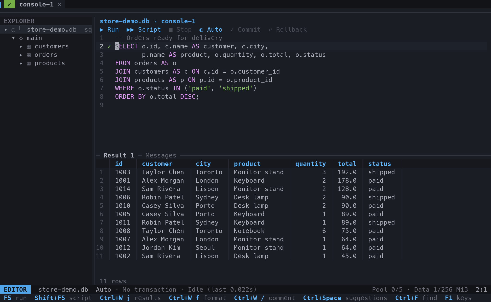
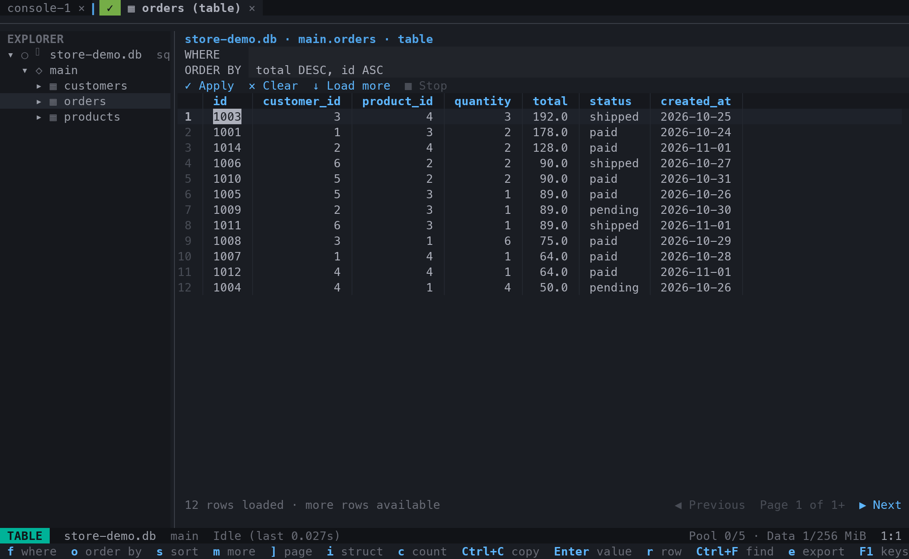
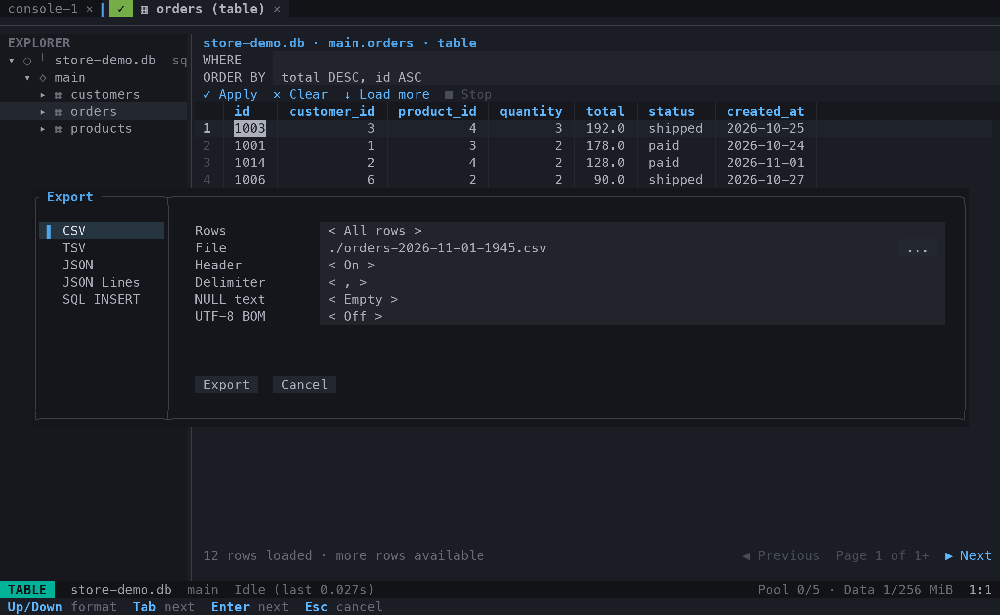

# SQLN

A terminal database client with several connections, SQL consoles, and table tabs.

SQLN brings an editor, a database navigator, and a results grid into one terminal.
Use familiar editor keys or Vim mode. Keep scripts with a project, or use global connections across projects.

**Databases:** SQLite, DuckDB, PostgreSQL, MySQL, Redis, Valkey, and Kafka with the Schema Registry.

> SQLN is in development. This repository supports source installation and unsigned workflow binaries.
> Review the [known limitations](#known-limitations) before use with important data.



*Write SQL, browse the catalog, and inspect results in one terminal.*

## Contents

- [Features](#features)
- [Screenshots](#screenshots)
- [Installation](#installation)
- [Quick start](#quick-start)
- [Keyboard guide](#keyboard-guide)
- [Tables and results](#tables-and-results)
- [Transactions and execution](#transactions-and-execution)
- [Configuration and saved work](#configuration-and-saved-work)
- [Credentials and connection security](#credentials-and-connection-security)
- [Local MCP assistant](#local-mcp-assistant)
- [Command-line reference](#command-line-reference)
- [Troubleshooting](#troubleshooting)
- [Known limitations](#known-limitations)
- [Development and automation](#development-and-automation)
- [Documentation](#documentation)
- [License](#license)

## Features

- **Several connections and consoles.** Keep independent scripts and table tabs open together.
- **Two editor modes.** Use conventional keys or Vim, with search, replace, undo, and SQL highlighting.
- **Catalog autocomplete.** Complete schemas, tables, views, columns, aliases, SQL keywords, built-in types, and functions with signatures.
- **SQL tools.** Format statements, toggle comments, and generate SQL templates from the navigator.
- **Local syntax warnings.** Check SQL after a typing pause, without executing it. Open full warnings from the command palette.
- **Query parameters.** Write `:name` values, fill the panel under the editor, and run with native bindings that keep values out of the SQL text.
- **Table browsing.** Apply SQL filters, sort columns, move between pages, and count rows on request.
- **Grid editing.** Change, insert, and delete table rows locally, review the SQL, and apply checked changes in one transaction.
- **Key navigation.** Go from a row to the row that its foreign key reads, or to the rows of other tables that read it.
- **Database objects.** See routines, sequences, triggers, and types in the navigator, and open the DDL of an object in a new console.
- **Results inspection.** Select cells, search loaded rows, inspect a row vertically, and format JSON values.
- **Local analysis.** Profile a column, draw text charts, and compare two console executions without another query.
- **Export.** Write CSV, TSV, JSON, JSON Lines, or SQL inserts from the export dialog.
- **Import.** Load CSV, TSV, JSON, or JSON Lines into a table, with column mapping and a preview.
- **Execution controls.** Run a statement, a selection, or a script, with row limits, deadlines, and cancellation.
- **Auto-refresh.** Repeat the last run of a console, or the page of a table, at a fixed interval.
- **Query plans.** See the plan of a statement as a tree, with the share of each node.
- **Server sessions.** List the sessions of PostgreSQL or MySQL, cancel a query, or end a session.
- **ER diagrams.** Draw the tables and foreign keys of a schema or a table, and copy the diagram as Mermaid text.
- **Compare.** Compare table structures or data across SQL connections, and open a sync script without running it.
- **Transactions.** Use autocommit or manual mode, with transaction state and age on screen.
- **Saved work.** Save consoles automatically and reopen tabs with their cursor, scroll, and layout.
- **External SQL files.** Open a `.sql` file from disk as a console: a copy of its text, or a link that writes the file on `Ctrl+S` with change checks.
- **Credential storage.** Use session passwords, macOS Keychain, or Linux Secret Service.
- **Appearance.** Choose themes, per-connection colors and icons, and optional Nerd Font symbols.
- **Local MCP assistant.** Connect Claude Code or OpenCode to an open SQLN instance. Approve read access, review SQL edits, or give full access.
- **No telemetry.** SQLN does not send usage reports.

## Screenshots

These captures use sample SQLite data and the Astrodark theme.
A virtual terminal captures the running application. Font appearance can differ in your terminal.

### Table browsing

Browse rows in a table tab, set the sort order, and load the next page without changing your SQL console.



### Export

Choose the output format, rows, file, and formatting options before writing an export.



## Installation

### Requirements

- macOS or Linux.
- A terminal with Unicode support. Truecolor is optional; Nerd Fonts are optional.
- A current stable Rust toolchain, with Cargo, for source installation.
- A native compiler and linker. SQLite is bundled and needs a C compiler.
- `cmake` and `perl`. The Kafka client builds librdkafka and OpenSSL from source.

The project does not declare a minimum Rust version. CI checks the current stable toolchain.

On macOS, install the command-line development tools if you do not have them:

```sh
xcode-select --install
```

On Debian or Ubuntu, install the native build tools and the libcurl headers:

```sh
sudo apt-get update
sudo apt-get install --yes build-essential libcurl4-openssl-dev
```

Install Rust with [rustup](https://rustup.rs/) if needed.
A database server is not required to build SQLN or to use SQLite.
Linux password storage needs a running Secret Service in the desktop session.

### Install from source

Run these commands from a checkout of this repository:

```sh
cargo install --path . --locked
sqln --version
sqln
```

Cargo places the executable in `~/.cargo/bin` by default. Add that folder to `PATH` if needed.

To run without installation:

```sh
cargo run --release --locked
```

To pass an application argument through Cargo:

```sh
cargo run --release --locked -- ./existing.db
```

For a missing SQLite file, SQLN asks before allowing creation. Cancel leaves the console without that database.

### Workflow build artifacts

The **Build binaries** workflow produces archives for:

| Platform | Target |
|---|---|
| Linux, x86-64, GNU libc | `x86_64-unknown-linux-gnu` |
| macOS, Apple Silicon | `aarch64-apple-darwin` |

Manual runs provide workflow artifacts. Version-tag runs also attach the archives to a GitHub Release.
See [manual binary builds](#manual-binary-builds) and [releases](#releases) for instructions.
Linux artifacts use Ubuntu 24.04 and are not static binaries. Older Linux systems can require a source build.
macOS artifacts target Apple Silicon. Intel Macs require a source build.
The macOS artifacts are not signed or notarized. They do not replace signed release binaries.

## Quick start

### Open a database

Open an existing SQLite file:

```sh
sqln ./existing.db
```

Open a DuckDB file, or one database in memory:

```sh
sqln duckdb:./analytics.duckdb
sqln duckdb:
```

Or connect to a server:

```sh
sqln 'postgres://alice@localhost/my_database'
sqln 'mysql://alice@localhost/my_database'
sqln 'redis://localhost/0'
sqln 'valkey://localhost/0'
sqln 'kafka://localhost:9092'
```

For PostgreSQL and MySQL, SQLN asks for a password when the URI omits it in an interactive terminal.
For password-protected Redis, Valkey, or Kafka with SASL, use the connection form to enter the password without shell-history exposure.

A command-line connection lasts for the session only. It does not create a saved connection or saved consoles for that target.
To save a connection, start `sqln` and add it through the navigator.

**Do not place passwords in shell commands.** A URI password can appear in shell history and process arguments.

### Use a saved connection

1. Start `sqln`.
2. Press `Ctrl+W`, then `h`, to focus the navigator.
3. Press `a` to open the connection form.
4. Select the database type.
5. Enter the address and other connection fields.
6. Use **Test** to check the connection.
7. Save the connection in the global or project scope.
8. Press `Enter` on the connection to open a console.

Use `Tab` to move through form fields. Passwords stay in the session unless you explicitly select storage.

### Run your first query

For SQLite, PostgreSQL, or MySQL, enter:

```sql
SELECT 1 AS example;
```

Press `F5`, or press `Ctrl+W`, then `e`, to run it.
The results appear below the editor. Use `Ctrl+W j` to move down to the grid.

For Redis or Valkey, use a command instead:

```text
PING
```

Each Redis command occupies one line. Redis consoles do not run SQL.

Kafka accepts a read-only SELECT subset. It does not need a SQL server or ksqlDB:

```sql
SELECT *
FROM orders
START AT EARLIEST
WHERE value.status = 'failed'
LIMIT 100
SCAN 50000;

SELECT timestamp, key, value.customer.id AS customer_id
FROM orders
EMIT CHANGES;
```

- Plain SELECT uses a finite read, as CONSUME. It starts at EARLIEST by default.
- EMIT CHANGES uses a continuous read, as TAIL. It starts at LATEST by default and waits until **Stop**.
- Use `START AT OFFSET 1500` or `START AT TIMESTAMP '2026-11-10T12:00:00Z'` for another start. `PARTITION 2` restricts the read to one partition.
- LIMIT caps matching rows. SCAN caps examined messages. EMIT CHANGES accepts neither; its live row cap removes the oldest rows.
- Select `*`, message columns, or `value.field` paths, with optional `AS alias`. Missing paths, tombstones, and values without JSON return NULL for a path. Whole columns keep bytes and NULL unchanged.
- SELECT can span lines. End it with `;` before another statement. A final SELECT can omit `;`. Use `#` at the start of a line for comments.
- Filters still run locally. Joins, aggregates, expressions, and ORDER BY are not supported. Reads have no global order across partitions.

The native commands remain available, one per line. Each command only reads:

```text
TOPICS
PARTITIONS orders
CONSUME orders FROM earliest WHERE value.customer.id = 42 AND key CONTAINS 'eu' LIMIT 100
CONSUME orders PARTITION 2 FROM @2026-11-10T12:00:00Z SCAN 50000
TAIL orders WHERE value.status = 'failed'
GROUPS
GROUP billing
```

- `CONSUME` reads to the last message of each partition at its start. `TAIL` waits for new messages until **Stop**.
- `FROM` takes `earliest`, `latest`, an offset, or `@` and a UTC time.
- Both SELECT and the native commands use the same filter in SQLN, after the decoding: `key = 'text'`, `CONTAINS 'text'` (without case), `MATCHES 'regex'`, and `value.field` with `=`, `!=`, `<`, `<=`, `>`, or `>=`. Use `AND`, `OR`, `NOT`, and parentheses.
- With a Schema Registry, Avro, JSON Schema, and Protobuf values become JSON. A value that does not decode stays as bytes, with a note in **Messages**.
- SQLN never joins a consumer group and never commits an offset. `GROUP <id>` shows the committed offsets and the lag.
- The explorer lists `topics` and `groups`. `Enter` on a topic opens its last 500 messages, newest first, with a filter field.

Press `Ctrl+P` for the command palette or `F1` for help in the main panels.

## Keyboard guide

`Ctrl+W e` means: press `Ctrl+W`, release it, then press `e`.
The prefix menu shows the available second keys. Press `Esc` to cancel it.
Uppercase keys matter: `Ctrl+W C` and `Ctrl+W c` are different actions.

### Main actions

| Action | Shortcut |
|---|---|
| Command palette | `Ctrl+P` or `Ctrl+W :` |
| Help | `F1` or `Ctrl+W ?` |
| Change panel | `Ctrl+W h/j/k/l` or `Ctrl+W`, then an arrow |
| Next / previous main tab | `Ctrl+W n` / `Ctrl+W p` |
| Run selection or current statement | `F5` or `Ctrl+W e` |
| Run the whole script | `Shift+F5` or `Ctrl+W s` |
| Show the sessions of the server | `Ctrl+W S` |
| Show the ER diagram of the tab or the row | `Ctrl+W D` |
| Compare the tab or the row | `Ctrl+W v` |
| Follow a key of the row of a table tab | `Ctrl+W F` |
| Open the commands of the explorer | `Ctrl+W Tab` |
| Open the commands of the current panel | `Ctrl+W Space` |
| Show the plan of a statement | `Ctrl+W E` |
| Run a statement and show its plan | `Ctrl+W A` |
| Stop execution | `Ctrl+W x` |
| Save console now | `Ctrl+S` |
| Rename console | `Ctrl+W N` |
| Change or attach console connection | `Ctrl+W a` |
| Format SQL | `Ctrl+W f` |
| Toggle line comments | `Ctrl+W /` |
| Query history | `Ctrl+W H` |
| Settings | `Ctrl+W ,` |
| Close tab | `Ctrl+W c` |
| Quit | `Ctrl+W q` |

`Ctrl+Enter` also runs the current query when the terminal supports enhanced keyboard input.
Use the prefix alternatives if the terminal does not deliver a shortcut.

**`Ctrl+C` copies; it does not stop execution or quit SQLN.** Use `Ctrl+W x` to stop and `Ctrl+W q` to quit.

### Editor

Conventional mode is the default. Change **Keyboard** in Settings to select Vim mode.

| Action | Conventional | Vim |
|---|---|---|
| Insert text | Type | `i`, `a`, or `o` |
| Select text | `Shift` + arrows | `v` |
| Undo | `Ctrl+Z` | `u` |
| Redo | `Ctrl+Y` | `Ctrl+R` |
| Copy / cut / paste | `Ctrl+C` / `Ctrl+X` / `Ctrl+V` | `y` / `d` / `p` |
| Search | `Ctrl+F` | `/` |
| Search and replace | `Ctrl+F`, then `Tab` | `Ctrl+F`, then `Tab` |
| Open suggestions | `Ctrl+Space` | `Ctrl+Space` in insert mode |

Suggestions also appear as you type. `Tab` accepts a suggestion by default; `Enter` inserts a new line.
Change **Autocomplete** in Settings if you prefer `Enter` or both keys to accept suggestions.

**AI completion** is optional. Configure it in **Settings > Autocomplete**, globally or per project.
Open suggestions, press `Up` from the first local item to select **Complete with AI…**, and use the acceptance key.
The answer shows as ghost text in the editor. Press `Tab` to accept it and `Esc` to reject it. Completion works at the cursor only and never runs generated SQL.
One OpenAI-compatible chat endpoint serves the requests, with OpenRouter as the default. Local servers use their OpenAI-compatible base. Keys use the system vault or a rotating key file.
See [AI completion](docs/AI_COMPLETION.md) for consent, context limits, and configuration.

### Navigator

| Action | Key |
|---|---|
| Open connection, table, or view | `Enter` |
| Open the DDL of a routine, sequence, trigger, or type | `Enter` |
| Open console list / create console | `n` |
| Add / edit connection | `a` / `e` |
| Refresh catalog | `r` |
| Filter loaded tables, views, and other objects | `/` |
| Inspect structure | `i` |
| Show the ER diagram | `d` |
| Compare structure or data | `c` |
| Show server sessions | `S` |
| Generate SQL templates or the DDL | `g` |
| Copy object name | `y` |
| Disconnect | `D` |
| Remove saved password, with confirmation | `p` |

The tree filter searches loaded catalogs only. It does not open a connection to find more objects.

Under each schema, the navigator shows a group for each kind of object after the tables and views: **Routines**, **Sequences**, **Triggers**, and **Types**. An empty group does not appear.
The **DDL** entry of the `g` list, or `Enter` on an object, reads the DDL and opens it in a new console of the connection. Nothing runs.
PostgreSQL has no function that gives the DDL of a table, a sequence, or a type, so SQLN writes that text from the catalog, and a comment at the top says so.

The hint row puts common commands first and shows more commands on wider terminals. It keeps the command palette shortcut visible.
Press `Ctrl+W Space` for the current panel commands. Press `Ctrl+W Tab` for the commands of the selected explorer row.
The explorer page uses the same keys as the table above and works from any panel. Its title names the target row.
The palette offers explorer row actions only with explorer focus. Add connection and scripts without a connection stay global.

The [full key map](docs/KEYMAP.md) covers forms, dialogs, export, mouse controls, and custom shortcuts.

## Tables and results

Press `Enter` on a table or view to open its table tab.

- Press `f` for the `WHERE` field, or `o` for `ORDER BY`.
- Enter a SQL expression in `WHERE`, without the `WHERE` keyword.
- Press `Enter` to apply the filter and order.
- Press `s` to sort the current column, or click a column header.
- Press `[` and `]` for previous and next pages.
- Press `m` to load more rows.
- Press `c` to count rows for the applied filter. SQLN does not count automatically.
- Press `F` to follow a foreign key of the current row. `→` marks a key that leaves the table, and `←` marks a key of another table that reads the row.

`F` opens the tab of the other table with a `WHERE` filter of the key values. An open tab of that table keeps its `ORDER BY` and gets the new filter.
With one key, SQLN goes there at once; with more keys, it shows a list. A key with `NULL` in the row stays out of the list.

Use an explicit, unique `ORDER BY` when stable page order matters.
Pages use offsets; concurrent database changes can still move rows between pages.
Redis and Valkey use key-value views instead of SQL filter fields.

### Edit table values

Grid editing supports SQLite, PostgreSQL, and MySQL InnoDB tables with a primary key.
Views, console results, binary values, key columns, identities, and generated columns stay protected.
Read-only connections do not offer editing.

1. Select a non-key cell in a table tab.
2. Press `F2` to open its value editor.
3. Change the value.
4. Press `F2` or `Ctrl+S` to keep the value locally.
5. Press `Ctrl+S` in the grid to review the pending values and SQL.
6. Press `F2` in the review to apply the changes.

Production connections ask for another confirmation.
`Ctrl+N` sets a cell to SQL `NULL`; empty text and the text `NULL` remain different.
`n` appends one pending row for insert; an empty cell of a pending row uses the table default, and a natural key stays editable.
`d` marks a row for delete, or removes a pending row; a marked row returns to its original values, and a second press removes the mark.
`Ctrl+R` opens the review. `Ctrl+D` asks before discarding pending changes.
Use the palette if your terminal does not send a `Ctrl` shortcut.

A `*` and underline mark each changed cell; `+` and `-` beside a row number mark a pending insert and a pending delete.
The summary shows the pending update, delete, and insert counts.
Typing and keeping a value do not write to the database.
Copy, export, import, filtering, sorting, and page changes require resolving pending changes first.

### Repeat a view

The `autoRefresh` command, in the palette and in the page of `Ctrl+W Space`, repeats the
tab on screen at a fixed interval: Off, 1s, 2s, 5s, 10s, 30s, or 60s.
A console repeats the exact statements of its last run with the current parameter values;
a table tab reads the page of the cursor again with the same filter and order.
A last run that can change data refuses to arm, and a failed repetition turns the
refresh off. The status line and the table summary show `auto Ns`.
Closing a dirty table offers Apply, Discard, and Cancel. Pending changes stay in memory only.

Apply checks the original rows under database locks and updates all pending rows in one transaction.
A conflict or error keeps the local values and rolls back the transaction.
A confirmed commit reloads the first page, including trigger changes, without applying draft filter text.
The cursor and selection return by primary key when their rows remain on that page.
An unknown commit result blocks another apply. Verify the database, then discard the local changes and reload.
SQLN never retries a write automatically.
Triggers and functions with external or nontransactional effects cannot provide an all-or-nothing guarantee.

### Inspect, copy, and export

In a results grid:

- Press `Enter` to inspect a cell, or `r` to inspect a row vertically.
- Press `f` in a value window to toggle JSON formatting. Row windows keep JSON compact.
- Press `Ctrl+F` in conventional mode, or `/` in Vim mode, to search loaded rows.
- Copy a selection as TSV with `Ctrl+C`, or `y` in Vim mode.
- Press `e` to open the export dialog.

Without a selection, copy uses the current cell. Grid search never queries the database.

Export supports CSV, TSV, JSON, JSON Lines, and SQL inserts.
Choose a selection, loaded rows, or all rows. An all-rows export can run a new read and observe newer data.
Only the **Export** button writes the file. `Esc` cancels the dialog.

### Analyze loaded results

Use these commands in an idle console result or table grid:

| Key | Command |
|---|---|
| `p` | Profile the current column: NULL count and percentage, distinct values without NULL, numeric min/max, and histogram |
| `b` | Choose a bar or line chart and two numeric columns |
| `B` | Turn previous-result retention on or off for the console |
| `D` | Compare the current execution with the retained previous execution |

The palette and `Ctrl+W Space` offer the same commands and show custom shortcuts.
Profiles and charts use only loaded rows, or the current table page. An incomplete result carries a label.
Distinct counts use the same value equality as data comparison. Numeric min/max keep decimal precision.
Histograms and chart positions use approximate numbers; non-finite or out-of-range chart pairs stay out with a count.
Charts preserve row order. Each repeated X has its own position; X spacing does not represent numeric distance.
Line charts use consecutive sections without sampling. Scroll to see every section and its point values.

For execution comparison:

1. Press `B` in the first complete result to enable retention.
2. Run the next query. The previous result stays in the shared memory budget.
3. Press `D`, select key columns with `Enter`, and choose **Compare with selected key columns**.

Comparison requires one complete data result per execution, the same column names and order, and unique selected keys.
It reports added, removed, and changed rows; row order alone does not count as a change.
Retention keeps one previous result per console until replacement, release, or console close. It does not persist across restarts.
A failed or incomplete execution releases the retained result and records a warning in Messages.
An analysis failure or memory limit cancels the report without partial differences, retries, or another query.
The current grid remains available. Pending table edits block analysis.
Press `Esc` to cancel or close, use arrows, PageUp/PageDown, or the mouse wheel to scroll, and `Ctrl+C` to copy.

### Import a file

Press `I` on a table in the navigator, or in the grid of a table tab.

1. Choose a file. The dialog detects the format and the delimiter.
2. Check the mapping in **Columns**. A column without a file column keeps its default.
3. Choose what a failure does in **Options**.
4. Check the first rows in **Preview**, and press **Import**.

| Mode | On a failed row |
|---|---|
| All or nothing | The first error undoes the whole import. This mode is the start of each dialog |
| By batch | The first error stops the import. The saved batches stay |
| Log errors | The bad row goes to a log file, and the import continues. It stops after the error limit |

The import only adds rows to an existing table.
The log holds the rows of the file in plain text.
A connection marked as production asks before the import.

For a `.sql` file, use **Open a SQL file as a console** in the command palette or start SQLN with `--script <file>`. Opening the file does not run it; review it and use `Shift+F5` or `Ctrl+W S` to run the script.

### Query plans

Press `Ctrl+W E` to see the plan of the selection or of the statement at the cursor.
The **Plan** tab shows a tree. The **Share** column shows the part of the work of each node.
The database does not run the statement for this plan.

Press `Ctrl+W A` (`explainAnalyze` in the palette) to run the statement and see the real time and rows of each node.
Node times include their child nodes and multiply the average loop time by the loop count.
SQLN asks first when the statement can write. On PostgreSQL, the change stays.

| Database | `Ctrl+W E` | `Ctrl+W A` |
|---|---|---|
| PostgreSQL | Cost and rows | Cost, rows, time, and loops |
| MySQL 8.0.16 or newer | Cost and rows | Cost, rows, time, and loops |
| SQLite | Steps only | Not available |

A plan uses one statement. The query history does not record plans.

### Server sessions

Press `S` in the navigator to open the sessions of a PostgreSQL or MySQL server.
Press `Ctrl+W S` in any panel to open the sessions of the connection of the current tab.
The list shows each session that the database user can see, except the session that reads the list.

- Press `q` to cancel the query of the session under the cursor. The session stays open.
- Press `K` to end the session. The database undoes its open transaction.
- Press `R` to read the list again.

SQLN asks before `q` and `K`. A read-only connection refuses both keys.
The database user needs the right to act on the sessions of other users.

### ER diagrams

Press `d` in the navigator to draw the tables and the foreign keys of the row.
Press `Ctrl+W D` in any panel to draw the table of the current tab, or the current schema of the console.
A schema shows all its tables. A table shows the table and the tables that its keys join, one step away. A connection shows its current schema.
Each box shows the columns, their types, and the key marks. A line goes from the foreign key column to the column that it reads, and the arrow points to that table.

- Press the arrows, or `h`, `j`, `k`, and `l` in the Vim mode, to select the nearest table in a direction.
- Press `Shift` and an arrow, `PageUp`, or `PageDown` to move the view. The wheel and a drag also move it.
- Press `Enter` to open the data of the selected table, or `i` to open its structure.
- Press `K` to show only the key columns, and press it again to show all the columns.
- Press `y` to copy the diagram as Mermaid `erDiagram` text. GitHub and GitLab show that text as a diagram.
- Press `R` to read the diagram again after a schema change.

Views and the partitions of a PostgreSQL table stay out. A table of another schema shows only its name.
Redis and Valkey have no diagram.

## Transactions and execution

Consoles start in autocommit mode. Each console runs one statement at a time within its script.
A statement error, timeout, or stop ends the remaining script.

| Action | Shortcut |
|---|---|
| Toggle autocommit / manual mode | `Ctrl+W m` |
| Commit | `Ctrl+W C` |
| Rollback | `Ctrl+W R` |

**Commit and rollback shortcuts act immediately, without another confirmation.**
The status line shows transaction state and the age of an open transaction.
Closing a console with an open transaction requires a decision.

SQLN uses a connection pool. Do not rely on temporary tables or session settings surviving between separate executions.
A session that waits in the pool for the **Idle limit** of the connection form closes, with 300 seconds as the default. The next use opens a new session. A console with an open transaction keeps its session.
The **Schemas** field of the connection form (**Databases** in MySQL and Redis) limits the schemas that the explorer, the schema selector, the compare dialog, and completion show. `Ctrl+O` opens a list of the server to mark them. The current schema always appears.
Keep dependent statements in one script or an open transaction.
Redis and Valkey do not offer the SQL manual-transaction controls.

Row caps and the result-memory budget limit how much data SQLN loads. A capped result is not the full result set.
By default, SQLN adds `LIMIT` with the row cap and one row to eligible plain reads without their own limit.
This can reduce database work. Sorting without an index can still require a full scan. **Messages** shows each added `LIMIT`. Turn off **Limit in SQL** in Settings > Results to send the text unchanged.
Change limits in Settings and statement deadlines in the connection form.
Cancellation depends on the database response; **Stop** is not a rollback guarantee.

SQLN asks before `UPDATE` or `DELETE` without `WHERE` and before state changes on a production-marked connection.
These checks are aids, not a security boundary. Use database permissions and backups to protect important data.

## Configuration and saved work

### Global and project scopes

| Scope | Folder | Use |
|---|---|---|
| Global | `$XDG_CONFIG_HOME/sqln`, or `~/.config/sqln` | Personal connections and defaults |
| Project | `<project>/.sqln` | Project connections, preferences, and consoles |

The global path also applies on macOS. `XDG_CONFIG_HOME` must be absolute to override the default.
SQLN searches upward from the working folder for the nearest `.sqln` directory.
A `.git` directory alone does not define an SQLN project.

Select a project folder explicitly:

```sh
sqln --project /path/to/project
```

SQLN offers to create the project configuration if the folder has no `.sqln` directory.
Preferences apply in this order: built-in defaults, global settings, then project settings.
Project settings override only the values they declare. Both scopes contribute saved connections.

Use `Ctrl+W ,` for Settings. The dialog shows scopes and inherited values.
Select **Shortcuts** to see the list of all configurable commands and their assigned shortcuts.
Select a command to record key sequences, remove shortcuts, or restore its inherited keys.
Select **Mouse OK** to include `Enter` in a recording.
Settings blocks conflicting shortcuts before saving them to the selected scope's `config.json`.
See [shortcut configuration](docs/KEYMAP.md#configuration) for the complete steps.

### Files

| File or folder | Content |
|---|---|
| `config.json` | Connections and preferences |
| `consoles/<id>.sql` | Saved console text |
| `consoles/<id>.json` | Console identity and metadata |
| `workspace.json` | Open tabs, cursor, scroll, and layout |
| `locks/` | Locks for concurrent instances |
| Global `history.jsonl` | Query history |
| Global `trust.json` | Confirmed destinations and project paths |
| Global `credentials.json` | Explicitly authorized plain-text fallback passwords, when used |

Saved consoles autosave 500 ms after the last edit. `Ctrl+S` saves immediately.
SQLN reports write failures and detects external script changes instead of silently replacing them.
Tabs reopen by default; turn off **Reopen tabs** in Settings if needed.

Project creation writes `.sqln/.gitignore` for workspace state, locks, and temporary files.
Connection definitions and saved SQL can still enter Git. Review them before sharing a project.
Autosave and history can contain sensitive SQL and literal values. They are not encrypted.

### Configuration example

Prefer Settings for routine changes. This complete minimal `config.json` shows the file format:

```json
{
  "version": 1,
  "preferences": {
    "keyboardMode": "conventional",
    "theme": "auto",
    "icons": "unicode",
    "reopenTabs": true,
    "queryHistory": false,
    "suggestionKeys": "tab"
  },
  "connections": []
}
```

Do not replace an existing configuration with this example: its empty connection list removes saved definitions from that file.
SQLN reports invalid configuration with its file and position. Correct it before restarting or reloading.
Press `Ctrl+W r` to reload configuration.

Available themes: `auto`, `astrodark`, `ansi`, `tokyo-night`, `catppuccin-mocha`, `catppuccin-latte`, `gruvbox`, `nord`, `dracula`, `one-dark`, `monokai`, `solarized-dark`, `solarized-light`, `github-dark`, `rose-pine`, `high-contrast`, `high-contrast-light`, `everforest`, `kanagawa`, `night-owl`, `rose-pine-dawn`, `everforest-light`, and `ember`.
Use `ansi` for the terminal palette. Set `NO_COLOR=1` to remove colors.
Select `nerd` icons only if the terminal uses a Nerd Font.

## Credentials and connection security

### Password storage

Passwords stay in the session by default. Saving requires an explicit choice.

- **macOS:** system Keychain.
- **Linux:** Secret Service, such as GNOME Keyring, in the user session.
- **No supported vault:** SQLN can offer a global plain-text fallback after explicit confirmation.

A vault error does not silently enable plain-text storage. SQLN offers retry, session use, or cancellation.
A real Linux desktop unlock dialog still needs manual validation; container tests do not cover that dialog.

Imported destinations and new project paths require trust confirmation before stored-credential access.
Use `p` in the navigator to remove a saved password. Removing a connection asks about password deletion separately.

### TLS

Remote addresses use TLS with certificate and hostname verification by default.
`localhost`, loopback IP addresses, and Unix sockets default to no TLS.
Use `sslmode=verify-full` to require verified TLS explicitly, including for a local endpoint:

```sh
sqln 'postgres://alice@db.example.com/app?sslmode=verify-full'
sqln 'mysql://alice@db.example.com/app?sslmode=verify-full&sslrootcert=/path/to/ca.crt'
sqln 'rediss://redis.example.com/0'
sqln 'valkeys://valkey.example.com/0'
```

The form also accepts CA files and client certificates.
URI parameters include `sslrootcert`, `sslcert`, and `sslkey`; a client certificate requires both certificate and key.
MySQL client keys can use PKCS#1, PKCS#8, or SEC1 format. PostgreSQL client keys use PKCS#8 in the test setup.

SQLN does not use an unverified TLS fallback. Even `sslmode=require` and `verify-ca` use full verification.
An explicit `sslmode=disable` removes TLS; use it only when the connection environment permits unencrypted traffic.
`rediss`, `valkeys`, and `kafkas` always require verified TLS.
Kafka takes `sasl=plain`, `sasl=scram-sha-256`, or `sasl=scram-sha-512` (the default) for a user, and `registry=<url>` for the Schema Registry.
Without a CA file, Kafka verifies with the system roots only.

### Local data and diagnostics

Query history is on by default. SQLN filters recognized secret-bearing statements, but SQL literals can still contain sensitive data.
Disable **Query history** when needed. This does not remove old history or saved console text.

`--log` records event kinds without SQL, result values, or passwords.
Before sharing any diagnostic file, inspect it for private paths and connection details.

## Local MCP assistant

Keep SQLN open and configure your client to start `sqln mcp` through stdio.
The bridge discovers instances, including instances without a project. Each client needs approval in SQLN once per run of SQLN.
Agents can read loaded results, execute read-only queries, propose SQL edits, and use metadata and analysis tools.
Tools wait for their result, so one call returns the rows of a query.
**Full access** also lets the agent write to the database. Production runs and writes without `WHERE` still ask you.

See [MCP setup, tools, and security](docs/MCP.md) for global Claude Code and OpenCode configuration.
**Settings > MCP** turns MCP on or off and sets the default and the maximum access, per project or globally.

## Command-line reference

```text
sqln [options] [target]
sqln mcp
```

`target` is one SQLite file path, one DuckDB target with the `duckdb:` scheme, or one connection URI. SQLN asks before creating a missing file.
Supported URI schemes include `postgres`, `postgresql`, `mysql`, `mariadb`, `redis`, `rediss`, `valkey`, `valkeys`, `kafka`, and `kafkas`.

| Option | Purpose |
|---|---|
| `--project <folder>` | Select the project root |
| `--script <file>` | Open a `.sql` file as a console at the start; it needs a target or a saved connection |
| `--execute <SQL>` | Run SQL without the terminal interface; `-` reads the script from standard input |
| `--output csv\|json` | Set the result format for `--execute`; optional |
| `--connection <name>` | Select a saved connection for `--execute` instead of a target |
| `--scope global\|project` | Select the scope when a saved connection name is ambiguous |
| `--single-transaction` | Run the whole script in one transaction that rolls back on any failure |
| `--continue-on-error` | Keep running after a failed instruction and report every failure |
| `--yes` | Authorize protected execution and missing database creation; it does not authorize trust |
| `--password-file <file>` | Read the batch password from a UTF-8 file |
| `--log <file>` | Write the event log |
| `-h`, `--help` | Show command-line help |
| `-V`, `--version` | Show the version |
| `--dialect <name>` | Set `postgres`, `mysql`, `sqlite`, `duckdb`, `redis`, or `kafka` for an unconnected console; development option |

### Execution without the terminal interface

```bash
sqln app.db --execute "SELECT * FROM users" --output csv > users.csv
sqln --connection production --execute "SELECT count(*) FROM users" --output json
sqln --connection staging --execute "DELETE FROM logs" --output json --yes
SQLN_PASSWORD="$DB_PASSWORD" sqln --connection app --execute "SELECT 1" --output json
sqln --connection app --password-file /run/secrets/db-password --execute "SELECT 1" --output csv
sqln app.db --execute - --output csv < migration.sql
sqln app.db --execute - --single-transaction --continue-on-error < migration.sql
```

`--execute` runs one instruction or a script of several instructions, in order, on one session.
It accepts a final semicolon, comments, and the `DELIMITER` rule. Use `-` to read the SQL from standard input,
up to 10 MiB; an empty input is an invalid argument. Do not combine `--execute` with `--script` or `--dialect`.
Supply exactly one target or `--connection`. Names ignore case. Use `--scope global` or `--scope project` for an ambiguous name.
Relative paths of saved connections keep their configured base folder.

Standard output contains only CSV or JSON, and it stays empty without `--output`. CSV has a header, a comma delimiter, UTF-8, and no BOM.
JSON is one array of objects per result set, one set per line, and uses the existing export rules for numbers, binary values, and repeated names.
Several result sets are written in order: CSV repeats the header for each set.
An empty result writes the CSV header or `[]`. A command without columns leaves standard output empty and reports affected rows on standard error.
Without `--output`, every result set reports its row count on standard error.
Database notices and failures also go to standard error. Export dialog preferences do not change these formats.
CSV preserves control bytes and formula-like text. Redirect output to a file or pipe when values are untrusted.

Execution streams all rows, without the grid cap or an added `LIMIT`. The connection SQL timeout still applies.
On Unix, the statement deadline stays active through the final output flush, including blocked output after the query returns.
Notices and affected-row messages on standard error also stop after cancellation or timeout.
The default stops the script at the first failed instruction. `--continue-on-error` runs the rest and reports every failure with its number.
`--single-transaction` opens one transaction, commits when every instruction succeeds, and rolls back on any failure or signal; Redis refuses the flag.
SQLN finishes and flushes result output before the final `COMMIT`; a failure during that flush triggers rollback.
Output can reach the consumer before `COMMIT`, even when `COMMIT` later fails. A successful flush does not guarantee consumer storage.
A script that ends its own transaction makes the final `COMMIT` fail. On PostgreSQL, a failure inside the transaction can make later instructions fail with the server message.
An instruction outside `--single-transaction` that leaves a transaction open fails and SQLN rolls it back.

Without `--yes`, protected execution and missing database creation need a terminal confirmation. The default answer is No.
The question uses the controlling terminal, so redirected input and output stay separate.
Without a terminal, SQLN refuses the operation and reports the required authorization.
`--yes` does not remove read-only or TLS protection. Trust for a saved network connection remains a separate terminal confirmation.
For CI, first confirm the saved destination and project interactively on that machine.

Password priority is `--password-file`, then `SQLN_PASSWORD`, then the saved credential or URI password, then a hidden terminal question.
The file is UTF-8. SQLN removes one final LF or CRLF and preserves other whitespace.
A file read failure does not fall back to another source. SQLN does not save passwords from these sources.
Without a credential or terminal, password-free authentication remains available. A missing referenced credential fails with instructions.
A URI password remains visible in shell history and process arguments. SQL text in `--execute` can also appear there.

SIGINT and SIGTERM request cancellation. A broken pipe or output failure also stops execution.
An error can leave partial or invalid output. Database changes can already be committed when output fails or cancellation arrives.
A full or broken standard error stream can prevent the final error message from appearing. The exit status still reports failure.
Always check the exit status: `0` means success, `1` means an operational failure or refusal, and `2` means invalid arguments.
SQLN does not restore tabs, start MCP, or write workspace, console, history, or export-preference files in this mode.

The terminal interface does not read SQL scripts from standard input.
`sqln mcp` uses standard input and output only for MCP. It does not accept raw SQL.
A positional `.sql` path is not a script-opening argument; positional file targets are SQLite databases. Use `--script` to open a `.sql` file as a console.

## Troubleshooting

| Problem | What to check |
|---|---|
| `sqln` is not found | Add Cargo's executable folder to `PATH`, or use `cargo run --release --locked` |
| A shortcut does not arrive | Use `Ctrl+W` alternatives, or open the palette with `Ctrl+W :` |
| Copy or paste behaves differently on macOS | `Cmd+C` copies the terminal selection; `Ctrl+C` copies the SQLN selection |
| Native mouse selection does not work | SQLN captures the mouse; iTerm supports native selection while you hold `Option` |
| Icons appear as empty boxes | Choose Unicode icons, or install and select a Nerd Font |
| Theme colors look wrong | Choose `ansi`, or use `NO_COLOR=1 sqln` |
| A remote connection fails TLS verification | Check the hostname, CA chain, system clock, and configured CA file |
| The Linux vault is unavailable | Check the session D-Bus and Secret Service; use session-only passwords if necessary |
| SQLite cannot open a file | Check that the file exists and that its folder and file permissions allow access |
| A result contains fewer rows than expected | Check the row cap, page controls, and result-memory budget |
| A temporary table disappears | Keep dependent statements in one script or transaction; pooled sessions reset between executions |
| A query continues after Stop | Cancellation needs a database response; inspect server activity and transaction state |

## Known limitations

- Local syntax warnings use a parser, not the database. They can miss errors or flag valid extensions, including some MySQL routines. See [syntax warnings](docs/UI.md#local-sql-syntax-warnings) for limits.
- Windows support is not part of the current CI or binary matrix.
- A `:memory:` SQLite or DuckDB database lives in the single session of its connection: a disconnect or the end of the application loses it.
- DuckDB opens a database file, and it refuses a `CSV`, `Parquet`, or `JSON` file: read those from a database with `read_csv`, `read_parquet`, or `read_json`, because a driver open of one of them would start a database in memory that loses its tables when the console ends.
- DuckDB lacks schema compare, ER diagram, the DDL window, `EXPLAIN`, grid editing, and foreign-key reads. A read-only DuckDB connection opens the file with `access_mode = READ_ONLY`; the global read-only preference refuses a write in the connector instead, because a DuckDB connection cannot change its access mode. The bundled build compiles DuckDB and makes the first build long.
- A DuckDB console can `ATTACH` other databases. Their schemas appear in the navigator with the `catalog.schema` name, and SQLN opens their tables with the catalog name, because a schema name alone cannot reach them. An `ATTACH` is not saved in the database file: it ends when the connection closes. A local DuckDB schema whose own name has a dot does not open, because SQLN reads the dot as the catalog separator.
- Grid editing changes, inserts, and deletes rows of keyed table tabs. Use SQL for binary values or other grids.
- A console linked to an external `.sql` file lives in the session only: closing SQLN closes it, and the file keeps its text. The file must be UTF-8, and the link has no autosave: `Ctrl+S` and the close questions write it.
- There is no integrated SSH tunnel, IAM authentication, or Kerberos authentication.
- MariaDB has no tree plan, so `Ctrl+W E` shows the error of the server. MySQL has no tree plan for a write on one table.
- PostgreSQL `COPY FROM STDIN` and `COPY TO STDOUT` are not supported.
- An ER diagram has no search, no zoom, and no export to an image file. The Mermaid copy holds the boxes on screen.
- The DDL of a PostgreSQL table that SQLN writes leaves out partitions, inheritance, comments, grants, the owner, storage options, policies, and triggers. MySQL gives the DDL of a routine or a trigger only with the privilege to see it.
- Key navigation acts only in a table tab. A console result does not tell the table of a column.
- Query parameters support SQLite, DuckDB, PostgreSQL, and MySQL consoles with scalar values. Table filters, Redis, and Valkey have none.
- Search in results covers loaded rows only. Exporting all rows can issue a new read.
- Import cannot create a table, update rows, or read SQL files. A MyISAM table cannot undo an import.
- Conventional undo uses `undoLimitBytes`, with 64 MiB per console by default. The newest undo and redo steps stay even above that limit.
- Vim undo and redo keep up to 100 full-text entries each, without a memory budget. Large scripts can use substantial memory.
- Native terminals, clipboard behavior, network disks, real network failures, and desktop vault prompts need further manual validation.
- Workflow builds do not provide signing, notarization, or a dependency audit.

## Development and automation

### Local checks

```sh
make fmt     # Format Rust code.
make lint    # Check formatting and Clippy.
make test    # Run tests without requiring database servers.
make check   # Run lint and the complete default test suite.
make bench   # Print the performance and memory reports and run the latency targets.
```

Development builds, Clippy, and tests use level-one optimization without debug info.
The test profile inherits the development profile to reduce duplicate dependency builds.
Debug assertions and incremental compilation stay enabled.
Set `CARGO_PROFILE_DEV_DEBUG=2` or `CARGO_PROFILE_TEST_DEBUG=2` when a backtrace needs symbols.
Use consistent profiles and compiler flags across agent commands to reuse the cache.
These settings do not remove existing build artifacts.
Test binaries run in parallel, with one binary per two logical CPUs and four test threads each.
Formatting and test-file checks run first, before compilation.
The under-20-second target applies to local checks with an up-to-date build cache, without database servers.
The first build takes longer, especially when Cargo compiles bundled DuckDB.
Database-dependent tests skip when their environment is absent. A passing local check alone does not prove database integration.
Native-vault tests require explicit authorization. Performance tests do not run as benchmarks in the default debug suite.

### Database integration

Docker Compose is required. The test stack uses disposable databases and loopback-only ports.

```sh
make test-integration
```

The command starts the databases, loads the test environment, runs the tests, and stops the databases.

For TLS coverage, use a Bash shell:

```bash
(
  set -e
  trap 'docker compose -f compose.test.yaml --profile tls down' EXIT
  scripts/test-certs.sh
  docker compose -f compose.test.yaml --profile tls up -d --wait
  . scripts/test-env.sh
  export SQLN_TEST_TLS=1
  make check
)
```

The certificate script replaces `.test-certs/` with disposable test certificates. Never use them outside the test stack.
The TLS stack includes PostgreSQL, MySQL, and Redis endpoints.

### Continuous integration

[`.github/workflows/ci.yml`](.github/workflows/ci.yml) runs on pushes to any branch, including `main`:

- Formatting, Clippy, and the default test suite on Linux and macOS.
- Database integration on Linux, with PostgreSQL, MySQL, Redis, Valkey, Kafka, the Schema Registry, and TLS endpoints.
- Database logs on failure and stack cleanup after the integration job.

Opening a pull request does not start another run. The pull request shows checks from its branch commit.
CI tests that commit, not a temporary merge with `main`. A merge into `main` starts a new push run.
Tag pushes do not start this workflow.

CI does not run benchmarks or authorized native-vault probes.
It does not replace real-terminal or desktop-vault checks.

### Manual binary builds

[`.github/workflows/binaries.yml`](.github/workflows/binaries.yml) supports manual builds through **workflow_dispatch**.
A manual build does not publish a release, even when you select a tag.
GitHub shows **Run workflow** after the workflow exists on the default branch.

1. Open the repository's **Actions** tab.
2. Select **Build binaries**.
3. Select **Run workflow** and the source ref.
4. Download the artifact for your platform after the job completes.
5. Extract the downloaded artifact ZIP.
6. Verify the archive checksum with `shasum -a 256 -c <archive>.sha256`.
7. Extract the `.tar.gz` archive.
8. Run `./sqln --version` inside the extracted folder.

Each archive includes `sqln`, this README, both license files, and build information with the source commit and Rust version.
Artifacts remain available for 14 days, subject to repository retention settings.
Checksums detect changed archive bytes; they are not signatures or proof of publisher identity.

The workflow builds and checks `--help` and `--version`. Run CI for the same commit before distributing an artifact.
It does not publish to crates.io, sign binaries, or notarize macOS builds.
No additional publishing or signing secrets are required.

### Releases

Pushing a tag that starts with `v` starts the two binary builds in the same workflow.
After both builds pass, a separate job verifies checksums and publishes a GitHub Release for that tag.
The release includes the two `.tar.gz` archives, their checksum files, and generated release notes.

**A version-tag push authorizes public release publication.** Do not push the tag until the version is ready.
The workflow does not wait for branch CI. Confirm its success for the same commit before creating a release tag.

1. Update the package version in `Cargo.toml` and `Cargo.lock`.
2. Commit the version change.
3. Push the commit.
4. Confirm that its CI checks pass.
5. Create the matching tag, such as `git tag v0.1.0`.
6. Push the tag with `git push origin v0.1.0`.
7. Download the archives from the repository's **Releases** page after the workflow completes.

The release job alone has `contents: write` permission. It uses GitHub's built-in `GITHUB_TOKEN`.
Build jobs have read-only repository access. Manual runs skip the release job.
A failed build prevents publication. This process does not publish to crates.io or sign or notarize binaries.

### Contributing

Keep changes small and add tests for changed behavior. Run `make check` before submitting a change.
Run integration tests when a change affects connectors or database integration.
Report the OS, terminal, SQLN version, and reproduction steps for a defect. Remove secrets from reports and sample SQL.

## Documentation

The rendered documentation site lives at <https://toninho09.github.io/sqln/>.

- [Feature map](docs/FEATURE-MAP.md): features and their source files.
- [Keyboard reference](docs/KEYMAP.md): complete navigation and shortcut guide.
- [Architecture](docs/ARCHITECTURE.md): execution, storage, credentials, and module rules.
- [Decisions](docs/DECISIONS.md): approved choices and tradeoffs.
- [UI reference](docs/UI.md): interface structure and layouts.
- [AI completion](docs/AI_COMPLETION.md): setup, providers, limits, and consent.
- [Local MCP assistant](docs/MCP.md): client setup, tools, and security.
- [Consolidated plan](docs/INITIAL_PLAN.md): scope, implementation state, and pending release checks.
- [Technical test results](docs/RESULTS.md): initial driver and terminal investigations.
- [External tools research](docs/TOOLS.md): how other tools solve the same points.
- [Pagination validation](docs/PAGINATION-VALIDATION.md): pagination checks and their limits.

## License

SQLN is available under either the [MIT license](LICENSE-MIT) or the [Apache License 2.0](LICENSE-APACHE), at your option.
